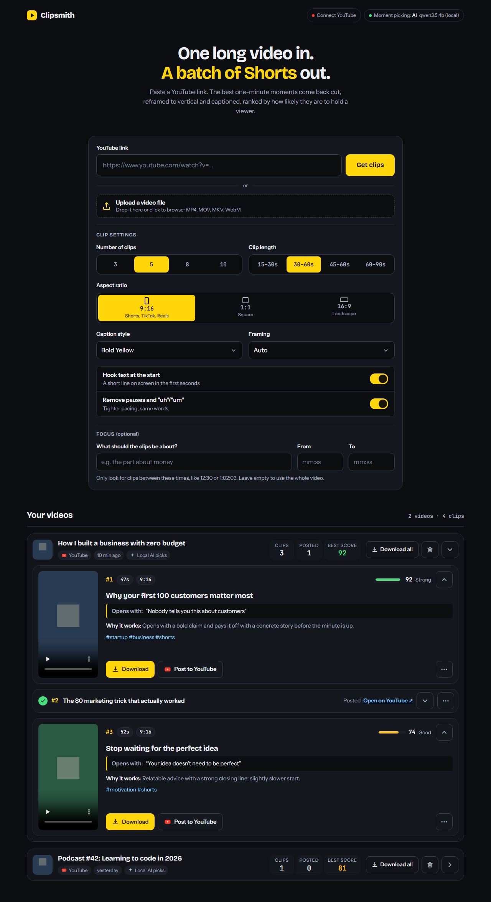

# ReelCraft AI

**An open-source video clipping studio. Turn a long video into captioned vertical clips with ReelCraft AI.**

[](https://github.com/AbdulSamad94/clipsmith/actions/workflows/tests.yml)
[](LICENSE)

[](https://github.com/AbdulSamad94/clipsmith/stargazers)

Paste a YouTube link or upload a video. ReelCraft AI finds the best 30–60 second moments, crops them to vertical 9:16 around the speaker, burns in animated word-by-word captions, and ranks them by how likely they are to hold a viewer.

- **Google sign-in** with Free, Normal, Premium and Gold quotas and plan-based feature access.
- **Cloud-ready processing** using Groq transcription, Gemini moment selection, MongoDB account data and Cloudinary clip storage.
- **Download clips** individually or as a ZIP; YouTube publishing is not included.



## What it does

1. **Downloads** the video and YouTube's captions (or transcribes the audio with Whisper if there are none).
2. **Picks the moments** that open strong, stand on their own and end on a complete thought, and gives each a viral score, a title, an on-screen hook, a caption and hashtags.
3. **Reframes** to 9:16, following the speaker's face. Wide shots get the full frame over a blurred background instead.
4. **Captions** every word as it's spoken, in one of three styles.
5. **Exports** MP4s you can download individually or together as a ZIP.

## Install

You need **Python 3.10+**, **ffmpeg** and, for AI moment picking, **Ollama**.

### 1. Prerequisites

| | Windows | macOS | Linux |
|---|---|---|---|
| Python | [python.org](https://www.python.org/downloads/) | `brew install python` | your package manager |
| ffmpeg | `winget install Gyan.FFmpeg` | `brew install ffmpeg-full` | `sudo apt install ffmpeg` |
| Ollama | [ollama.com/download](https://ollama.com/download) | [ollama.com/download](https://ollama.com/download) | `curl -fsSL https://ollama.com/install.sh \| sh` |
| Deno *(YouTube downloads need a JS runtime)* | `winget install DenoLand.Deno` | `brew install deno` | `curl -fsSL https://deno.land/install.sh \| sh` |

Node.js works instead of Deno if you already have it.

ReelCraft AI needs FFmpeg's `ass` filter (libass) to render captions. Homebrew's `ffmpeg-full` is keg-only, so on macOS start ReelCraft AI with its binaries first:

```
PATH="$(brew --prefix ffmpeg-full)/bin:$PATH" ./run.sh
```

### 2. Download the AI model (about 3.3 GB, once)

```
ollama pull qwen3.5:4b
```

### 3. Set up ReelCraft AI

```
git clone https://github.com/AbdulSamad94/clipsmith.git
cd clipsmith
```

- **Windows:** double-click `setup.bat`
- **macOS / Linux:** `./setup.sh`

## Run locally

- **Windows:** double-click `run.bat`
- **macOS / Linux:** `./run.sh`

The account and plan features still require MongoDB, Google OAuth and the provider credentials below, even when running locally. Copy `.env.example` to `.env`, configure those services, then open **http://127.0.0.1:8765** and sign in with Google.

## Deploy on Render Free

The repository includes a Docker-based Render Blueprint in [`render.yaml`](./render.yaml). Create free accounts/services for Render, MongoDB Atlas, Google OAuth, Groq, Gemini and Cloudinary, then deploy the Blueprint and enter its environment secrets in Render. The Blueprint intentionally marks credentials as secret inputs; do not commit a real `.env` or paste secrets into source files.

Configure these values in Render:

| Variable | Purpose |
|---|---|
| `MONGODB_URI` | MongoDB Atlas connection URI for account, quota, plan and job metadata |
| `GOOGLE_CLIENT_ID` | Google OAuth web-client ID; authorize the deployed Render/custom-domain origin |
| `SESSION_SECRET` | Random session-signing value at least 32 characters long (for example, generate with `openssl rand -hex 32`) |
| `ADMIN_PASSWORD` | Unique administrator password at least 16 characters long; rotate any password previously shared in chat |
| `GEMINI_API_KEY` | Gemini API key for AI moment selection |
| `GROQ_API_KEY` | Groq API key for Whisper-compatible transcription |
| `CLOUDINARY_URL` | Cloudinary URL used for authenticated clip storage |
| `RAZORPAY_KEY_ID`, `RAZORPAY_KEY_SECRET` | Razorpay Checkout credentials; start with test credentials |

`ADMIN_EMAIL` is prefilled in the Blueprint; change it if a different administrator should be used. The Admin Panel is available at `/admin`. Regular accounts are created only after verified Google sign-in. Razorpay upgrades are activated only after the backend verifies the payment signature and confirms/captures the payment with Razorpay.

### Plans and hosting limits

| Plan | Price / month | Price / year | Allowance | Plan source limit |
|---|---:|---:|---:|---:|
| Free | ₹0 | ₹0 | 1 clip/month (15–30 seconds) | 10 minutes |
| Normal | ₹49 | ₹449 | 32 clips/month | 30 minutes |
| Premium | ₹99 | ₹899 | 90 clips/month | 90 minutes |
| Gold | ₹149 | ₹1,399 | Unlimited clips/month | 300 minutes |

On Render Free, a server-wide source-video cap applies to every plan: it defaults to **5 minutes** and the Admin Panel can raise it only up to **10 minutes**. The effective limit is the lower of that server cap and the account plan's limit. The service also limits uploads to 500 MiB and source video resolution to 1080p, processes one video at a time, and stores temporary media in `/tmp`. Render Free has limited memory, CPU, temporary storage and availability; these safeguards reduce resource pressure but cannot guarantee every render will finish without a timeout. Temporary files may be lost when the service restarts; interrupted jobs are marked failed and their unrendered clip allowance is refunded. Account quotas and job metadata are held in MongoDB, and generated clips in Cloudinary. Hosting stays within provider free tiers only while usage remains within their current free-tier quotas; payment processing may also incur fees.

## Using it

- **Clip settings:** pick the number of clips, the clip length and the aspect ratio (9:16, 1:1 or 16:9). Choose a caption style (each one shows a live preview; besides the original three there are Comic, Impact, Tall and a "Build-up" style where words appear one by one as they are spoken) and framing, and switch the opening hook text and pause/"uh" removal on or off.
- **Focus (optional):** describe what the clips should be about, or limit them to part of the video with **From** and **To** (like `12:30`).
- **Progress:** each video shows three steps (get the video, pick the best moments, cut and caption) with what's happening right now. Finished clips appear while the rest are still rendering.
- **Your clips:** each clip shows its rank, length, score, the hook it opens with and why it was picked. Download it, copy its caption from the **⋯** menu, or delete it. Older videos start folded.

The page works with a keyboard and a screen reader: every control has a label and a visible focus ring, and progress and upload changes are announced.

## How long it takes

On a 4-core laptop CPU, a 12-minute video takes about **10 minutes**: a few minutes for the AI to read it, then about 1–3 minutes per clip to render. Longer videos take proportionally longer. Fewer clips means faster results.

## Choosing the AI

Set this in `.env` (copy it from `.env.example`):

| Option | Cost | Speed | Setting |
|---|---|---|---|
| **Local Qwen** (default) | Free | Slow on CPU | `AI_PROVIDER=ollama` |
| Google Gemini | Free tier | Fast | `AI_PROVIDER=gemini` + `GEMINI_API_KEY` |
| Anthropic Claude | Paid | Fast | `AI_PROVIDER=claude` + `ANTHROPIC_API_KEY` |
| None | Free | Fastest | `AI_PROVIDER=none` (basic scoring by rules) |

On a machine with more RAM or a GPU, try a bigger local model for better picks, e.g. `OLLAMA_MODEL=qwen3.5:9b`.

## Known limitations

- The small local model sometimes gets facts or numbers wrong in titles. **Check titles before posting.**
- Face tracking is basic (OpenCV). Fast camera cuts can make the crop lag.
- Render Free's shared source-duration cap is lower than the longer plan limits; see the deployment notes above.

## Roadmap

- [x] Filler word and silence removal
- [x] "Prompt to clip": describe the moment you want
- [ ] Edit clip start/end and caption text before export
- [ ] Keyword and emoji highlights in captions
- [ ] Brand template (logo, fonts, colours)

Contributions are welcome! **Designers especially:** UI/UX ideas are wanted, see [issue #24](https://github.com/AbdulSamad94/clipsmith/issues/24). See [CONTRIBUTING.md](CONTRIBUTING.md) and the [`good first issue`](https://github.com/AbdulSamad94/clipsmith/labels/good%20first%20issue) label. If ReelCraft AI saves you time, a ⭐ helps other people find it.

## Use responsibly

Only post clips of videos you own, or that the creator allows you to clip (for example through a creator's clipping or affiliate program). Re-uploading other people's streams or videos without permission can lead to Content ID claims and copyright strikes.

Monetization is a separate question: YouTube's [reused-content policy](https://support.google.com/youtube/answer/1311392) is separate from copyright and **applies even if you have permission from the original creator**. Channels that mostly repost others' content with little of their own added can be refused monetization.

Downloading from YouTube may also break YouTube's Terms of Service. You are responsible for how you use this tool.

## License

[MIT](LICENSE)
