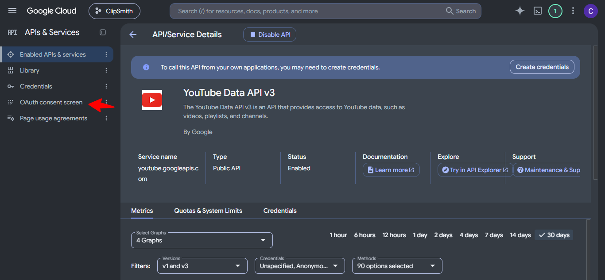
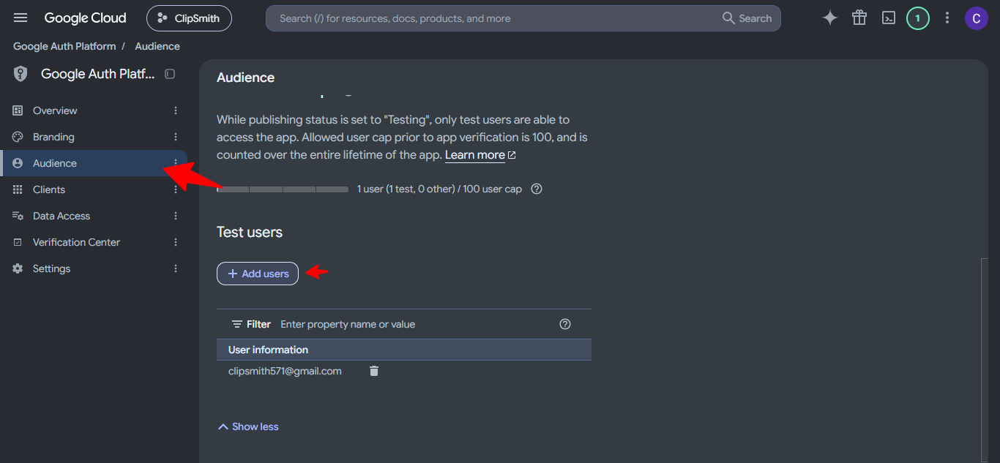

# Set up YouTube posting

Clipsmith posts clips to **your own** YouTube channel through Google's official YouTube Data API. Because Clipsmith runs on your computer, you create your own free Google "app" once. It takes about 5 minutes and costs nothing.

Nothing secret is shipped with Clipsmith: your keys stay in your `.env` file, and the YouTube login is saved in `data/youtube_token.json` on your computer.

## 1. Create a Google Cloud project

1. Open the [Google Cloud console](https://console.cloud.google.com/) and sign in with the Google account that owns your YouTube channel.
2. Create a new project (any name, e.g. `clipsmith`) and select it.

## 2. Turn on the YouTube Data API

1. Open the [API Library](https://console.cloud.google.com/apis/library).
2. Search for **YouTube Data API v3** and click **Enable**.

After enabling it, Google opens the API's details page.

## 3. Set up the consent screen

1. In the left menu, click **OAuth consent screen**:

   

2. Enter an app name (e.g. `Clipsmith`) and your email address.
3. For the audience, choose **External**.
4. Finish the setup with the default options.

## 4. Add yourself as a test user (required)

Your app stays in **Testing** mode, and in Testing **only the Google accounts you list can sign in**. Anyone else gets *"Access blocked: … has not completed the Google verification process"* (Error 403: access_denied).

1. In the left menu, open **Audience**.
2. Under **Test users**, click **Add users**.
3. Enter the email address of the Google account that owns your YouTube channel, and click **Save**. It then appears in the list under **User information**.

   

> **Testing mode signs you out every 7 days.** Google limits logins from Testing apps to 7 days, so once a week Clipsmith will say *"YouTube sign-in has expired"*. Click **Connect YouTube** again; it takes a few seconds. To avoid this, see [Optional: stay signed in](#optional-stay-signed-in-production-mode) below.

You don't need Google's app verification: apps for personal use with fewer than 100 users can be used without it.

## 5. Create the OAuth client

1. Go to **Menu → Google Auth platform → Clients** and click **Create Client**.
2. **Application type:** **Desktop app**. Name it anything and click **Create**.
3. Copy the **Client ID** and **Client secret**.

## 6. Add them to Clipsmith

Open the `.env` file in the Clipsmith folder and add:

```
YOUTUBE_CLIENT_ID=your-client-id.apps.googleusercontent.com
YOUTUBE_CLIENT_SECRET=your-client-secret
```

Restart Clipsmith (`run.bat` or `./run.sh`).

## 7. Connect your channel

1. Click **Connect YouTube** at the top of the Clipsmith page.
2. Choose the Google account you added as a test user in step 4. Google shows **"Google hasn't verified this app"**. That's expected for your own personal app: click **Advanced → Go to Clipsmith (unsafe)**. It's "unsafe" only in the sense that Google hasn't reviewed it; it's your own app.
3. Allow the permissions:
   - **Upload YouTube videos** (`youtube.upload`) to post clips.
   - **View your YouTube account** (`youtube.readonly`) so Clipsmith can show which channel is connected.
4. You're sent back to Clipsmith and the top bar shows your channel name.

## Posting

Click **Post to YouTube** on any clip. The title, description and hashtags are pre-filled from the AI and you can edit them.

- **Post now** or **Schedule**: a scheduled video is uploaded straight away as private, and **YouTube makes it public at the chosen time by itself**. Your computer doesn't need to be on. Scheduled posts are always public; to keep a clip unlisted or private, post it now with that visibility.
- **Made for kids**: YouTube requires an answer for every video.
- **Add the full video link**: puts a link to the original video between the description and the hashtags (only for clips made from a YouTube link).
- Vertical or square videos up to 3 minutes are treated as **Shorts** by YouTube automatically.

While a clip uploads, an **uploads tray** in the bottom-right corner shows its progress (minimize it with the arrow). Keep Clipsmith open until it finishes. Once a clip is posted, its card folds into one line with an **Open on YouTube** link; use the arrow to open it again. To post the same clip again, use the **⋯** menu on the clip. If an upload fails, the clip shows the reason and a **Try again** button.

## Limits

- Google allows **100 uploads per day** per Google Cloud project.
- Titles: up to 100 characters. Descriptions: up to 5000 bytes. Hashtags/tags: up to 500 characters in total. Clipsmith trims to these automatically.
- `<` and `>` aren't allowed in titles or descriptions; Clipsmith removes them.

## Disconnect

Click **Disconnect** at the top. Clipsmith revokes its access with Google and deletes the saved login. You can also remove access any time at [myaccount.google.com/permissions](https://myaccount.google.com/permissions).

## Optional: stay signed in (production mode)

Switching the app from **Testing** to **In production** removes the 7-day sign-out. Google only allows the switch once the app's **Branding** page has a valid app name, support email, **homepage URL** and **privacy policy URL**. Without them, Google shows *"Valid app name, support email, homepage url, and privacy policy url are required for switching the app to external production mode."*

If you have those URLs:
1. Fill them in on the **Branding** page.
2. On the **Audience** page, click **Publish app**.
3. In Clipsmith, click **Disconnect**, then **Connect YouTube** again.

If you don't, stay in Testing and reconnect once a week.

## Troubleshooting

| Message | Fix |
|---|---|
| "YouTube isn't set up yet" | Add `YOUTUBE_CLIENT_ID` and `YOUTUBE_CLIENT_SECRET` to `.env` and restart. |
| "Access blocked: … has not completed the Google verification process" (Error 403: access_denied) | Add your Google account as a **test user** (step 4), then connect again. |
| "YouTube sign-in has expired", once a week | Normal in Testing mode: click **Connect YouTube** again. To stop it, see [production mode](#optional-stay-signed-in-production-mode). |
| "daily limit of 100 uploads" | Wait until tomorrow (the quota resets daily). |
| `redirect_uri_mismatch` | Make sure the OAuth client type is **Desktop app**, not Web application, and open Clipsmith at `http://127.0.0.1:8765`. |
